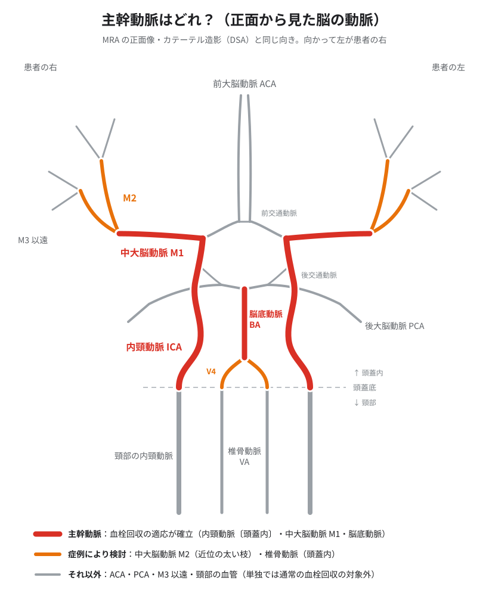

# 頭部 MRI：DWI・ADC・FLAIR の読み方（仕組みと実臨床）

> **方針**：この 3 つは **必ずセットで、同じ高さのスライスを横に並べて** 読む。
> 役割は **DWI ＝「今」何か起きているか**、**ADC ＝ その DWI の白が本物か**、
> **FLAIR ＝ どれくらい時間がたったか／過去の傷跡も含めた全履歴**。
> 出血は 3 つだけでは評価できないので **T2\*（または SWI）**、血管は **MRA** で別に見る。

- 対象：ER・病棟で頭部 MRI（脳卒中プロトコル）を自分で見る研修医・内科医
- 更新日：2026-11-19

---

## 0. 30 秒まとめ（これだけ覚える）

```
DWI    白い   → 水が「動けない」場所がある（急性期梗塞なら発症数十分〜で白）
ADC    黒い   → その DWI の白は本物（真の拡散制限）
       白/等  → 見かけだけ（T2 shine-through：古めの梗塞・浮腫など）
FLAIR  白くない → 発症から数時間以内らしい（DWI-FLAIR mismatch ≒ 4.5 h 以内）
       白い     → 数時間以上たっている。古い病変もすべて白く写る
```

---

## 1. 読み方と基本

| 略称 | 読み | 正式名 | 日本語 | ひとことで |
|---|---|---|---|---|
| DWI | ディーダブリューアイ（現場では「ディフュージョン」「拡散」） | Diffusion-Weighted Imaging | 拡散強調画像 | 水分子の **動きにくさ** を見る |
| ADC | エーディーシー（「ADC マップ」） | Apparent Diffusion Coefficient | みかけの拡散係数 | 水の **動きやすさ** を数値にした地図 |
| FLAIR | フレア | Fluid-Attenuated Inversion Recovery | 水抑制画像（液体減衰反転回復法） | **髄液だけ黒く消した T2 強調** |

**信号の言葉**
- 白 ＝ **高信号**、黒 ＝ **低信号**、周りと同じ ＝ **等信号**
- CT の「高吸収・低吸収」とは言い分ける（MRI で「低吸収」とは言わない）

### 1-1. 並んだ画像の見分け方

| | 髄液（脳室） | 灰白質 vs 白質 | 見た目の特徴 |
|---|---|---|---|
| DWI | 黒 | ほぼ差がない | ざらざらで解像度が低い。頭蓋底（側頭葉底面・前頭葉底面・脳幹）が歪んで白っぽくなる |
| ADC | **白** | ほぼ差がない | T2 っぽいがノイジー（計算で作った画像） |
| FLAIR | 黒 | 灰白質がやや白い | 解像度が高く、解剖がきれいに見える |

- FLAIR と T1 はどちらも髄液が黒い → **灰白質が白質より白ければ FLAIR**、白質のほうが白ければ T1
- DWI と ADC は **白黒が逆**（DWI で白い急性期梗塞は ADC で黒）

---

## 2. 仕組み

### 2-1. DWI：水の「動けなさ」を白く写す

1. 水分子は熱でたえず動き回っている（ブラウン運動＝**拡散**）
2. DWI では **MPG（motion probing gradient）** という傾斜磁場を 2 回かける
   - 1 回目で各プロトンの位相をずらし、2 回目で戻す
   - **その場にとどまっていた水** → きれいに戻る → 信号が残る（**白**）
   - **動いてしまった水** → 戻りきらない → 信号が消える（**黒**）
3. つまり **水が動けない（拡散制限）場所ほど白く残る**

- **b 値**：MPG の強さ。頭部は通常 **b = 1000 s/mm²**。b = 0 は MPG なし＝ほぼ T2 強調像
- **弱点**：DWI の土台は T2 強調（EPI 法）なので、**T2 で白いもの（浮腫など）も白く残ってしまう**
  → これを **T2 shine-through** という。だから ADC で確認が必要

**なぜ急性期梗塞は DWI で白くなるのか**

```
虚血 → ATP 枯渇 → Na⁺/K⁺-ATPase 停止
    → Na⁺ と水が細胞外から細胞内へ移動 → 細胞が膨れる（細胞性浮腫 cytotoxic edema）
    → 細胞外腔が狭く・迷路状になる → 水が動けない
    → DWI 白、ADC 黒（発症後 数十分で起きる）
```

- CT は組織の **水の総量** が増えないと写らない（数時間かかる）。DWI は水の **動きにくさ** を見るので、総量が増える前の早い段階で白くなる → **急性期梗塞で CT より圧倒的に早い**

**梗塞以外で拡散制限が起きる理由**
- 液体がドロドロ（**膿**）
- 細胞がぎっしり詰まっている（**悪性リンパ腫**など細胞密度の高い腫瘍）
- ケラチンの層構造（**類表皮嚢胞**）
- 髄鞘の中の浮腫（一部の中毒・代謝性脳症）

### 2-2. ADC：DWI から T2 の影響を取り除いた「本物」の地図

- b = 0 と b = 1000 の 2 枚で、信号がどれだけ落ちたかから計算する

```
S(b) = S(0) × e^(−b × ADC)   →   ADC = ln( S(0) / S(b) ) ÷ b
```

- 割り算で T2 の影響が打ち消される → **純粋な「水の動きやすさ」**
- 表示は **動きやすい（髄液）＝白、動けない＝黒**
- 目安：正常脳実質 0.7〜0.9 × 10⁻³ mm²/s、髄液 約 3.0 × 10⁻³ mm²/s。急性期梗塞はおおむね 3〜5 割低下
- 「Apparent（みかけの）」：生体では細胞膜・毛細血管の血流なども混ざるので、物理的な純粋な拡散係数ではない、という意味

> **DWI が白いときは必ず ADC を見る。ADC が黒ければ本物、白ければ見かけ。**

### 2-3. FLAIR：髄液だけ黒く消した T2 強調

- T2 強調は「水が多いところが白」。でも **髄液も真っ白** なので、脳室や脳溝に接する病変が髄液に埋もれて見えない
- FLAIR は最初に **180° 反転パルス** をかけ、縦磁化が戻ってくる途中で
  **髄液の縦磁化がちょうど 0 になる時間（TI、約 2 秒強）** に撮像を始める
  → **髄液だけ信号ゼロ（黒）**、残りは T2 強調のまま
- = **「髄液を消した T2」**。脳室周囲・皮質の病変がくっきり見える

**FLAIR で白く写るもの**
- 組織の中に **水が増えた** もの：血管性浮腫、グリオーシス（古い傷跡）、脱髄、炎症
- **純粋でない髄液**：血液（SAH）、蛋白・細胞の多い髄液（髄膜炎）← 消えずに白く残る
- 閉塞・狭窄血管内の **遅い血流**（FLAIR 血管内高信号）

**梗塞が FLAIR で白くなるのはいつか**
- 超急性期は水が細胞外→細胞内へ「移動」するだけで、組織の水の総量はまだあまり増えていない → **FLAIR はまだ白くない**
- 数時間たつと血液脳関門が傷み、組織全体の水が増える（イオン性・血管性浮腫）→ **FLAIR が白くなる**（早ければ 3 時間前後、多くは 6 時間までに）
- これが **DWI-FLAIR mismatch** の原理（5-2）

---

## 3. 3 つを並べたときの読む手順

```
Step 1  DWI で白いところを探す
Step 2  同じ場所の ADC を見る   → 黒：真の拡散制限 / 白・等：T2 shine-through
Step 3  同じ場所の FLAIR を見る → 白くない：新しい（数時間以内）/ 白い：数時間以上
Step 4  FLAIR だけで白いところ（DWI は白くない）→ 古い病変（陳旧性梗塞・白質病変）
Step 5  梗塞なら、病変の分布から機序を考える（5-1）
Step 6  出血は T2*/SWI（or CT）、血管は MRA で別に確認
```

### 3-1. DWI × ADC の組み合わせ

| DWI | ADC | 意味 | 代表例 |
|---|---|---|---|
| 白 | **黒** | **真の拡散制限** | 急性期梗塞、脳膿瘍、悪性リンパ腫、類表皮嚢胞、CJD、低血糖脳症、けいれん重積後 |
| 白 | 白〜等 | T2 shine-through（見かけだけ） | 亜急性期梗塞（1〜2 週〜）、血管性浮腫 |
| 黒〜等 | 白 | 水が動きやすい（自由水が多い） | 慢性期梗塞（嚢胞化）、血管性浮腫（PRES・腫瘍周囲）、髄液 |

**呼び方**
- **DWI 白・ADC 黒 → 拡散制限**（restricted diffusion）。「拡散低下」とも言う
  - 会話：「DWI（ディフュージョン）で光ってて、ADC が落ちてる」
  - 報告書・カルテ：「DWI 高信号、ADC 低下を伴う（→ 拡散制限）」
  - 本物であることを強調するときは「真の拡散制限」（T2 shine-through と区別するため）
- DWI 白・ADC 白〜等 → **T2 shine-through**（ティーツー・シャインスルー）
- DWI 等・ADC 白 → **T2 washout**（ティーツー・ウォッシュアウト）。血管性浮腫で多い

### 3-2. 拡散制限（急性期梗塞）があったら次に見るもの

**MRA は FLAIR の結果（mismatch の有無）に関係なく必ず見る。** FLAIR → MRA の順番ではなく、同時に並行して見る。

```
DWI 白・ADC 黒（急性期梗塞）
 ├ T2*/SWI：出血がないことを確認（rt-PA・抗血栓療法の前提）
 ├ MRA：主幹動脈閉塞（内頸動脈・M1・脳底動脈）はあるか？ ← 一番大きな分かれ道
 │   あり → 血栓回収を検討、脳血管内治療医をすぐコール
 │          発症 6 h 以内：NIHSS ≥ 6、DWI-ASPECTS ≥ 6 などで適応
 │          発症 6〜24 h：コア体積・灌流画像で判断（5-6、DAWN・DEFUSE 3）
 │          → カテ室でカテーテル血管造影（DSA）、診断と治療を同時に
 │   なし → 内科的治療（抗血栓療法）、原因検索
 └ FLAIR：rt-PA の時刻判定（時刻不明のときだけ mismatch が効く、5-2）
```

**「血管造影」の言葉の使い分け**

| 名前 | 読み | 中身 | いつ |
|---|---|---|---|
| MRA | エムアールエー | MRI で血管を描く。頭部は造影剤なし（TOF 法）が基本 | 脳卒中 MRI に最初から入っている |
| CTA | シーティーエー | 造影 CT で血管を描く | CT で初期評価する施設、MRI が撮れない患者 |
| DSA（脳血管撮影、アンギオ） | ディーエスエー | カテーテルを入れて直接造影 | 血栓回収のとき（治療と同時）。診断だけで最初にやることはまずない |

- 現場で「血管造影」「アンギオ」と言うと DSA（カテーテル）を指すことが多い。MRI の血管画像は「MRA」と言う
- FLAIR 血管内高信号（FVH）があれば、MRA での主幹動脈閉塞を特に意識して見る

**主幹動脈 ＝ どの血管か**



| 血管 | 略・読み | 血栓回収 | 詰まったときの症状の目安 |
|---|---|---|---|
| 内頸動脈（頭蓋内〜末端部） | ICA | **確立** | MCA＋ACA 領域。重度の片麻痺＋失語または無視＋共同偏視 |
| 中大脳動脈 M1（水平部） | エムワン | **確立** | 片麻痺（顔・腕優位）、失語（優位半球）、半側空間無視（劣位半球）、共同偏視（病巣側を見る） |
| 脳底動脈 | BA | **確立**（2022 年の RCT：ATTENTION・BAOCHE） | 意識障害、四肢麻痺、眼球運動障害、構音障害。重いのに「意識障害」として見逃されやすい |
| 中大脳動脈 M2（近位の太い枝） | エムツー | 症例により検討 | MCA 症状の一部（失語だけ、など） |
| 椎骨動脈（頭蓋内 V4） | VA | 症例により検討 | 延髄・小脳の症状。脳底動脈に波及しうる |
| 前大脳動脈・後大脳動脈・M3 以遠 | ACA・PCA | ルーチンでは対象外（2025 年の RCT：ESCAPE-MeVO・DISTAL で上乗せ効果なし） | ACA：下肢優位の麻痺、PCA：同名半盲 |

- **tandem 閉塞**：頸部の内頸動脈の閉塞・高度狭窄と、頭蓋内の主幹動脈閉塞が同時にある状態。血栓回収の対象（頸部にステントを置くこともある）
- MRA では、閉塞部から先の血管が **途切れて写らない**。必ず左右を見比べる
- **描出不良 ≠ 閉塞** のこともある：椎骨動脈は左右差（片側の低形成）が多く、遅い血流でも写りが悪くなる

### 3-3. 出血の確認：T2\*（と SWI・CT）

| 略称 | 読み | 正式名 | 日本語 |
|---|---|---|---|
| T2\* | ティーツースター（「T2 スター」） | T2\*-weighted gradient echo（GRE） | T2\* 強調画像 |
| SWI | エスダブリューアイ | Susceptibility-Weighted Imaging | 磁化率強調画像 |

**仕組み**
- 血液が分解されてできる **デオキシヘモグロビン・メトヘモグロビン・ヘモジデリン** は小さな磁石のような性質（常磁性）をもち、周りの磁場を乱す
- T2\* はグラディエントエコー法で撮る。スピンエコー法の 180° パルスのように磁場の乱れを打ち消す仕組みがないので、乱れた場所の信号が消える → **出血は黒（低信号）**
- 実際より大きく黒く見える（**blooming**）→ 小さな出血も見つけやすい
- SWI は同じ原理をさらに強めたもので、T2\* より感度が高い（微小出血をより多く拾う）

**T2\* で黒く写るもの**

| 所見 | 見え方 | 臨床の意味 |
|---|---|---|
| 脳出血 | 黒い塊 | 急性期の脳出血は CT と同等に検出できる。rt-PA・抗血栓療法の前に必ず確認 |
| 微小出血（microbleeds） | 数 mm の黒い点 | 深部（基底核・視床・脳幹）＝高血圧性、皮質・皮質下（lobar）＝脳アミロイド血管症を考える。多いと抗血栓療法・rt-PA での出血リスクが上がる |
| 出血性梗塞 | 梗塞の中の黒 | 梗塞後の出血性変化。抗血栓療法の判断に影響 |
| susceptibility vessel sign | 閉塞した血管の中の黒い線 | 赤血球の多い血栓 → 閉塞部位の手がかり、心原性塞栓を示唆 |
| 脳表ヘモジデリン沈着 | 脳表をなぞる黒い線 | 脳アミロイド血管症、過去のくも膜下出血 |
| 石灰化・金属・空気 | 黒 | **出血と紛らわしい**。石灰化か出血かは CT（または SWI の位相画像）で区別 |

**注意点**
- **ヘモジデリンは一生残る** → T2\* で黒い ＝ 今の出血、とは限らない。古い出血も黒い。急性か古いかは CT（急性期出血は高吸収）や臨床経過で判断
- **くも膜下出血は T2\* だけでは弱い**：急性期は CT が第一。MRI なら FLAIR（脳溝が白い）と T2\*（脳溝が黒い）を合わせて見る
- 頭蓋底（副鼻腔・側頭骨の近く）は空気・骨のアーチファクトで黒くなりやすい

---

## 4. 脳梗塞の時間経過（時期判定）

| 時期 | DWI | ADC | FLAIR |
|---|---|---|---|
| 超急性期（〜4.5 h 前後） | **白** | **黒** | **白くない**（← mismatch）。血管内高信号はありうる |
| 急性期（数時間〜数日） | 白 | 黒（3〜5 日で最も低い） | 白 |
| 亜急性期（1〜2 週） | 白（T2 shine-through 込み） | **偽正常化**（7〜10 日頃に周りと同じに見える） | 白 |
| 慢性期（数週〜） | 等〜黒 | 白 | 縁は白（グリオーシス）、中心は髄液と同じく黒（嚢胞化） |

- **DWI 白 ＝ 今日の梗塞、とは限らない**：T2 shine-through のせいで DWI の白は 2〜4 週ほど残ることがある → ADC で確認
- **ADC の偽正常化**：7〜10 日頃は ADC が周りと同じに見える。「ADC が黒くないから古い」と言い切るには DWI・FLAIR と合わせる

---

## 5. 実臨床での意味

### 5-1. 急性期脳梗塞の診断（DWI が主役）

- 急性期梗塞で **最も感度の高い検査**
- 高齢者で FLAIR に白い点がたくさんあるとき、**どれが今回か** は FLAIR ではわからない
  → **DWI 白 ＋ ADC 黒 が今回の病変**
- **DWI 陽性の TIA** は組織学的には梗塞（tissue-based definition）→ 再発リスクが高く、入院精査を考える

**病変の分布で機序を考える**

| DWI 病変の分布 | 考える機序 | 次の一手 |
|---|---|---|
| 複数の血管領域に散在（両側、前と後ろの循環にまたがる） | 心原性塞栓 | 心電図モニター（AF）、心エコー（TTE ± TEE） |
| 1 つの血管領域に小さい病変が多発 | 動脈原性塞栓（頸動脈・大動脈のプラーク） | 頸動脈エコー、MRA |
| 境界領域（皮質枝の境目、深部白質に数珠状） | 血行力学性（高度狭窄＋血圧低下） | 狭窄評価。過度な降圧を避ける |
| 穿通枝領域の小病変（<15 mm） | ラクナ梗塞 | 危険因子管理 |
| 穿通枝の起始部から長く伸びる（レンズ核線条体動脈で縦に 3 スライス以上、傍正中橋で底面に接する） | BAD（branch atheromatous disease） | 入院後の **症状進行** に注意 |

**虚血コアとしての DWI**
- DWI 病変 ≒ すでに救えない部分（**虚血コア**）。早期に再開通すると一部戻ることはある
- 症状が重いのに DWI 病変が小さい（**clinical-DWI mismatch**）→ まだ救える組織（ペナンブラ）が大きい → 血栓回収を考える根拠になる
- 日本では前方循環の評価に **DWI-ASPECTS** を使うことが多い（血栓回収の判断材料）

### 5-2. 発症時刻不明（wake-up stroke）：DWI-FLAIR mismatch

- 読み：**ディーダブリューアイ・フレア・ミスマッチ**（現場では「ディフュージョン・フレア・ミスマッチ」とも。文献では FLAIR-DWI mismatch と逆順のこともある）
- **DWI 白・ADC 黒なのに FLAIR で白くない** → 発症から 4.5 時間以内の可能性が高い
- **WAKE-UP 試験**（NEJM 2018）：発症時刻不明でも DWI-FLAIR mismatch があればアルテプラーゼで転帰が改善
- 日本の **静注血栓溶解（rt-PA）療法 適正治療指針 第三版（2019）** でも、発症時刻不明例で mismatch があれば静注血栓溶解を考慮できるとされている
- 精度は **4.5 h 以内の判定に感度 6 割・特異度 8 割程度**（PRE-FLAIR 研究）
  → mismatch あり＝4.5 h 以内の可能性が高い。ただし FLAIR が白くても 4.5 h 以内のことはある
- **mismatch なし（FLAIR も白い）でも急性期梗塞であることは変わらない**
  - DWI 白・ADC 黒なら、おおむね発症から 1 週間以内（ADC が偽正常化する前）の新しい梗塞
  - FLAIR が見ているのは「4.5 h を過ぎていそうか」だけ
- mismatch がないことで使えなくなるのは、**発症時刻不明例の rt-PA だけ**
  - 発症時刻がわかっていて 4.5 h 以内なら、rt-PA は時刻で判断する（FLAIR は時刻不明のときの代わりの時計）。ただし早期虚血変化が広範なら、別の理由で適応外になる
  - 主幹動脈閉塞があれば、発症 24 h までは血栓回収を考える（5-6）
  - 入院・抗血栓療法・原因検索は mismatch の有無に関係なく同じ
- **FLAIR 血管内高信号（FVH）**：閉塞・高度狭窄した血管の中の遅い血流が白く見える → 主幹動脈閉塞の手がかり。MRA と合わせて見る

### 5-3. めまい・後方循環：DWI は偽陰性がある

- **発症 24〜48 h 以内・後方循環・小さい梗塞** ほど DWI が白くならないことがある
  - 急性前庭症候群で、発症 48 h 以内の初回 DWI が 12% 偽陰性だった報告（Kattah 2009）
  - 1 cm 以下の小梗塞では約半数が見逃された報告もある
- 頭蓋底の磁化率アーチファクトで **脳幹・小脳が見にくい**
- → **DWI 陰性でも HINTS+ が中枢パターンなら梗塞として扱う**。薄いスライス・冠状断の DWI、24〜72 h 後の再検を考える
- 診察の手順は [めまい精査カルテテンプレ](vertigo-karte-template.md) へ

### 5-4. 梗塞以外で DWI 白・ADC 黒になるもの

| 疾患 | DWI/ADC の特徴 | 臨床の手がかり |
|---|---|---|
| 脳膿瘍 | リング状造影病変の **中心** が DWI 白・ADC 黒 | 壊死性腫瘍（膠芽腫・転移）は中心が DWI 黒・ADC 白 → **膿瘍と腫瘍の鑑別に強い** |
| 悪性リンパ腫 | 腫瘍全体の ADC が低い（細胞密度が高い） | 脳室周囲・脳梁、均一に造影。ステロイドは生検の後 |
| 類表皮嚢胞 | DWI が著明に白い | くも膜嚢胞は髄液と同じ（DWI 黒） |
| 低血糖脳症 | 皮質・海馬・基底核・内包・脳梁膨大部 | **まず血糖**。補正すれば戻りうる |
| けいれん重積後 | 皮質・海馬・視床枕（血管領域に一致しない） | 数日〜数週で消える |
| CJD | 皮質のリボン状高信号（cortical ribboning）、尾状核・被殻 | 急速進行性認知症。DWI が最も感度が高い |
| 一過性全健忘（TGA） | 海馬の点状高信号 | 発症 24〜72 h 後に出やすい（当日の MRI は陰性が多い） |
| MERS（可逆性脳梁膨大部病変を有する軽症脳炎・脳症） | 脳梁膨大部の楕円形高信号 | 感染に伴う。1 週間ほどで消える |
| ヘルペス脳炎 | 側頭葉内側・島の FLAIR 白 ＋ DWI 白 | 疑えば MRI を待たずにアシクロビル |
| 急性期の出血 | 時期によって DWI 白・ADC 黒になる | T2\*/SWI か CT で確認 |
| びまん性軸索損傷 | 灰白質と白質の境界、脳梁 | 頭部外傷 |

### 5-5. FLAIR が主役になる場面

| 場面 | FLAIR 所見 | ポイント |
|---|---|---|
| 梗塞の時期判定 | 4 章・5-2 | DWI とセットで |
| 慢性虚血性白質病変 | 脳室周囲・深部白質の高信号 | **Fazekas 分類**（脳室周囲 PVH 0〜3、深部 DWMH 0〜3）で書く。認知機能低下・転倒・脳卒中リスクの指標 |
| 多発性硬化症 | 脳室に垂直な卵円形の病変（Dawson's fingers）、皮質直下、脳梁 | 活動性病変は造影・DWI で |
| くも膜下出血 | 脳溝・脳槽の高信号 | CT 陰性の亜急性 SAH で有用。偽陽性あり（6 章） |
| 髄膜炎・癌性髄膜症 | 脳溝の高信号（造影 FLAIR でより鋭敏） | 診断は髄液検査 |
| PRES | 後頭葉・頭頂葉の皮質下白質の高信号。**DWI は白くない（ADC 上昇＝血管性浮腫）** | 高血圧・子癇・免疫抑制薬・腎不全。原因を除けば戻る。DWI で拡散制限があれば梗塞に移行しており予後不良 |
| 脳炎 | HSV：側頭葉内側・島、自己免疫性：辺縁系 | |
| Wernicke 脳症 | 視床内側・乳頭体・中脳水道周囲 | 疑えば MRI を待たずにビタミン B1 |
| 腫瘍周囲浮腫 | 腫瘍の周りの広い高信号 | 浮腫は ADC 上昇（血管性浮腫） |

### 5-6. いろいろな「ミスマッチ」

**ミスマッチ ＝ 2 つの画像（または症状と画像）で、病変の広さや有無がずれていること。**
脳梗塞のミスマッチは 2 系統に分けると整理しやすい。

```
時間の時計：発症からどれくらいたったか     → DWI-FLAIR mismatch だけ
組織の時計：まだ救える脳がどれくらい残るか → それ以外ほぼ全部
            「DWI（＝コア、もう救えない）」vs「危険にさらされている範囲」
            範囲の差 ＝ ペナンブラ（まだ救える脳）
```

| ミスマッチ | 読み | 何と何を比べるか | 意味 | 使い道 |
|---|---|---|---|---|
| DWI-FLAIR | ディーダブリューアイ・フレア | DWI 白なのに FLAIR は白くない | 発症 4.5 h 以内らしい | 時刻不明例の rt-PA（5-2） |
| PWI-DWI（灌流-拡散） | ピーダブリューアイ・ディーダブリューアイ（「パーフュージョン・ディフュージョン」） | 血流低下域（PWI）が DWI 病変より広い | 差 ＝ ペナンブラ | 発症 6 h 以降の血栓回収（DEFUSE 3）、海外では 4.5〜9 h・起床時発見例の rt-PA（EXTEND） |
| CT 灌流（CTP） | シーティー・パーフュージョン | 血流遅延域（Tmax 延長）がコア（脳血流の高度低下域）より広い | PWI-DWI の CT 版 | 同上。MRI が撮れない施設・患者 |
| Clinical-DWI（臨床-拡散） | クリニカル・ディフュージョン | 症状が重い（NIHSS 高い）のに DWI 病変が小さい | 症状の割にコアが小さい → 救える脳が多い | 発症 6〜24 h の血栓回収（DAWN） |
| MRA-DWI | エムアールエー・ディーダブリューアイ | 主幹動脈閉塞（内頸動脈・M1）があるのに DWI 病変が小さい | 閉塞血管の支配域の大部分がまだ梗塞になっていない | 灌流画像がないときの代用 |
| FVH-DWI | エフブイエイチ・ディーダブリューアイ | FLAIR 血管内高信号の範囲が DWI 病変より広い | 側副血行で持ちこたえている範囲 | 灌流画像がないときの代用 |

- 逆に **DWI 病変のほうが血流低下域より広い（逆ミスマッチ）** ときは、すでに再開通していることが多い
- ミスマッチは「救える脳がありそうか」の推定。血管が開けられるかは別問題

**血栓回収の代表的な基準**

```
DEFUSE 3（発症 6〜16 h、内頸動脈・M1 閉塞）＝ 灌流-コア mismatch
  コア < 70 mL かつ ミスマッチ比（血流低下域 ÷ コア）≥ 1.8 かつ 差 ≥ 15 mL

DAWN（発症 6〜24 h、内頸動脈・M1 閉塞）＝ clinical-core mismatch
  80 歳以上：NIHSS ≥ 10 かつ コア < 21 mL
  80 歳未満：NIHSS ≥ 10 かつ コア < 31 mL
            NIHSS ≥ 20 かつ コア 31〜<51 mL
```

- 自動解析ソフトでは、コアは **CT なら脳血流（rCBF）< 30%、MRI なら ADC < 620 × 10⁻⁶ mm²/s**、血流低下域は **Tmax > 6 秒** で計算されることが多い
- 日本の脳卒中治療ガイドライン 2021〔改訂 2023〕でも、これらの基準を満たす発症 6〜24 h の内頸動脈・M1 閉塞には血栓回収が勧められている

**脳梗塞以外のミスマッチ**

| ミスマッチ | 読み | 何と何を比べるか | 意味 |
|---|---|---|---|
| T2-FLAIR mismatch sign | ティーツー・フレア・ミスマッチ・サイン | T2 で一様に白い腫瘍が、FLAIR では中心が黒く縁だけ白い | **IDH 変異・1p/19q 非共欠失の星細胞腫** に特異度が非常に高い（感度は低い） |
| 換気-血流（V/Q）ミスマッチ | ブイキュー | 肺シンチで換気は正常なのに血流だけ欠損 | **肺塞栓**。造影 CT が使えないとき（腎障害・妊婦）に |
| 血流-代謝ミスマッチ（心筋） | — | 心筋血流は低下しているのに FDG の取り込みは保たれる | **冬眠心筋**（まだ生きている）→ 血行再建で壁運動が戻る見込み |

---

## 6. Pitfall

- **DWI 白 ≠ 梗塞**：ADC が黒いか、分布が血管支配に合うかを見る
- **DWI 白 ≠ 今日の梗塞**：T2 shine-through で 2〜4 週残る
- **DWI 陰性 ≠ 梗塞否定**：超急性期・後方循環・小病変、TGA（24〜72 h 後に出る）
- **頭蓋底アーチファクト**：側頭葉底面・前頭葉底面・橋の偽高信号や歪み。評価困難ならそう書く
- **FLAIR 白くない ≠ 正常**：超急性期梗塞は写らない（それが mismatch）
- **mismatch なし（FLAIR も白い）≠ 古い梗塞**：DWI 白・ADC 黒なら急性期梗塞。数時間以上たっているというだけ
- **FLAIR の脳溝高信号 ≠ SAH 確定**：高濃度酸素投与、プロポフォール鎮静、造影剤投与後（特に腎不全）、後頭蓋窩の髄液拍動アーチファクトでも白くなる
- **出血は 3 つでは評価できない**：T2\*/SWI、または CT
- **意識障害で DWI 皮質高信号**：梗塞と決めつけず、まず血糖・けいれんを考える

---

## 7. カルテ記載テンプレ（コピペ用）

```
【頭部MRI】（ /　 :　撮像、最終健常 　:　、発見 　:　）
DWI：高信号 −/＋（部位：　　　　　　血管支配：　　　　　単発/多発）
ADC：同部位 低下 −/＋（→ 拡散制限 / T2 shine-through）
FLAIR：同部位 高信号 −/＋（→ DWI-FLAIR mismatch 有・無）
　　　 血管内高信号 −/＋（　　）　白質病変 Fazekas PVH　 DWMH　　陳旧性梗塞 −/＋（　　）
T2*/SWI：出血 −/＋　微小出血 −/＋　　MRA：閉塞・狭窄 −/＋（　　）
DWI-ASPECTS：　点（前方循環のとき）
→ 新規病変 有・無 / 時期：超急性期・急性期・亜急性期・慢性期 / 推定機序：
```

**書き方のルール**
- 「DWI 陽性」「梗塞あり」とは書かず、**見えたもの（DWI 高信号・ADC 低下）** を書く。解釈は → の後か A へ
- 部位は **解剖（左放線冠）＋ 血管支配（左 MCA 穿通枝領域）** の両方
- **今回の病変（DWI 高・ADC 低）と陳旧性病変（FLAIR のみ）を分けて** 書く
- **時刻（最終健常・発見・撮像）を必ず書く**：mismatch の解釈と rt-PA の判断に直結する
- 頭蓋底アーチファクトで見えない部位は「評価困難」と書く。DWI 陰性を「梗塞なし」と書かない

### 7-1. 記載例

**起床時発見の右片麻痺（DWI-FLAIR mismatch）**
```
頭部MRI（11/19 08:40 撮像、最終健常 前日 23:00、発見 07:00）
DWI：左中心前回皮質〜皮質下に高信号（左 MCA 皮質枝領域、単発）
ADC：同部位 低下あり → 拡散制限
FLAIR：同部位に明らかな高信号なし → DWI-FLAIR mismatch あり
　　　 血管内高信号なし　白質病変 Fazekas PVH 1 DWMH 1　陳旧性梗塞なし
T2*：出血なし　MRA：主幹動脈閉塞なし
→ 新規病変あり / 超急性期（発症 4.5 h 以内の可能性が高い）
A：発症時刻不明だが mismatch ありのため rt-PA 適応を検討、脳卒中チームコール
```

**めまい・DWI 陰性**
```
頭部MRI（発症 6 h）
DWI：明らかな高信号なし（橋・小脳は頭蓋底アーチファクトで評価困難）
FLAIR：白質病変 Fazekas PVH 1 DWMH 1 のみ　T2*：出血なし　MRA：右椎骨動脈 描出不良
→ DWI 陰性だが、発症 48 h 以内の後方循環の小梗塞は否定できない
A：HINTS+ 中枢パターン（注視方向性眼振、skew＋）のため小脳梗塞疑いとして入院。
　 24〜72 h 後に薄いスライスで DWI 再検
```

---

## 8. 参考文献

- Allen LM, et al. Sequence-specific MR imaging findings that are useful in dating ischemic stroke. *RadioGraphics* 2012;32:1285-1297.
- Thomalla G, et al. DWI-FLAIR mismatch for the identification of patients with acute ischaemic stroke within 4·5 h of symptom onset (PRE-FLAIR). *Lancet Neurol* 2011;10:978-986.
- Thomalla G, et al. MRI-guided thrombolysis for stroke with unknown time of onset (WAKE-UP). *N Engl J Med* 2018;379:611-622.
- Albers GW, et al. Thrombectomy for stroke at 6 to 16 hours with selection by perfusion imaging (DEFUSE 3). *N Engl J Med* 2018;378:708-718.
- Nogueira RG, et al. Thrombectomy 6 to 24 hours after stroke with a mismatch between deficit and infarct (DAWN). *N Engl J Med* 2018;378:11-21.
- Ma H, et al. Thrombolysis guided by perfusion imaging up to 9 hours after onset of stroke (EXTEND). *N Engl J Med* 2019;380:1795-1803.
- Tao C, et al. Trial of endovascular treatment of acute basilar-artery occlusion (ATTENTION). *N Engl J Med* 2022;387:1361-1372.
- Jovin TG, et al. Trial of thrombectomy 6 to 24 hours after stroke due to basilar-artery occlusion (BAOCHE). *N Engl J Med* 2022;387:1373-1384.
- Goyal M, et al. Endovascular treatment of stroke due to medium-vessel occlusion (ESCAPE-MeVO). *N Engl J Med* 2025.
- Psychogios M, et al. Endovascular treatment for stroke due to occlusion of medium or distal vessels (DISTAL). *N Engl J Med* 2025.
- Dávalos A, et al. The clinical-DWI mismatch: a new diagnostic approach to the brain tissue at risk of infarction. *Neurology* 2004;62:2187-2192.
- Patel SH, et al. T2-FLAIR mismatch, an imaging biomarker for IDH and 1p/19q status in lower-grade gliomas. *Clin Cancer Res* 2017;23:6078-6085.
- Kattah JC, et al. HINTS to diagnose stroke in the acute vestibular syndrome. *Stroke* 2009;40:3504-3510.
- Saber Tehrani AS, et al. Small strokes causing severe vertigo: frequency of false-negative MRIs and nonlacunar mechanisms. *Neurology* 2014;83:169-173.
- Easton JD, et al. Definition and evaluation of transient ischemic attack. *Stroke* 2009;40:2276-2293.
- 日本脳卒中学会. 静注血栓溶解（rt-PA）療法 適正治療指針 第三版. 2019.
- 日本脳卒中学会. 脳卒中治療ガイドライン 2021〔改訂 2023〕.
